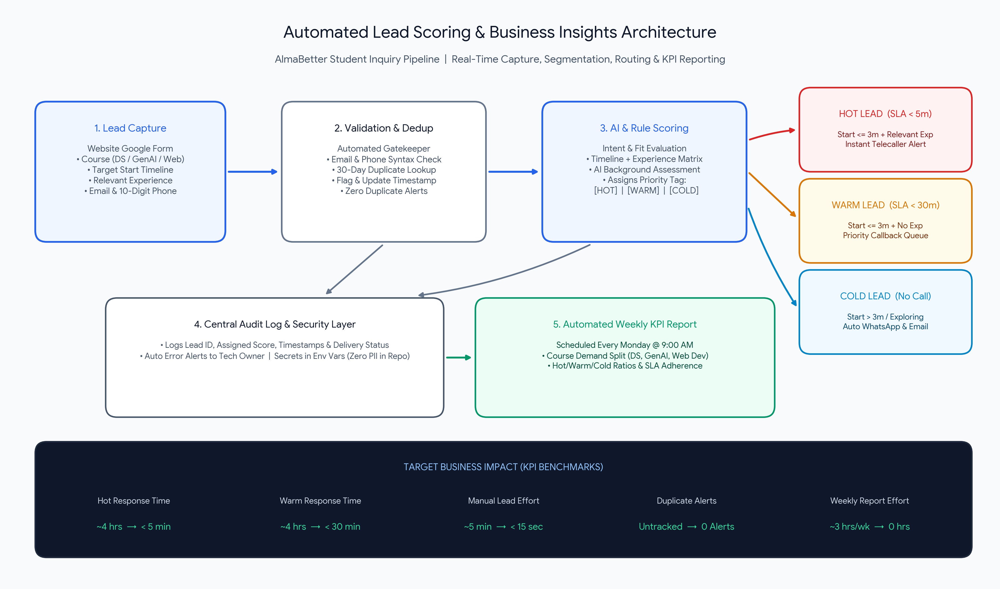

# Automated Lead Scoring & Business Insights Pipeline (n8n + AI)

An end-to-end automation that captures student enquiries, validates and de-duplicates them, scores them with rules + an LLM, routes them by priority, and sends an automated weekly KPI report.

> **Disclaimer:** This is a **simulated portfolio project** modelled on the enquiry-to-enrollment funnel of an edtech company like AlmaBetter. It is **not affiliated with, deployed at, or endorsed by AlmaBetter**. All lead data is **synthetic**. "As-Is" figures are **assumptions** used to frame the business case.

---

## 1. Business Problem

In a typical edtech admissions team, leads arrive through a website form and are handled manually:

- Leads are copied into spreadsheets by hand (slow, error-prone)
- Duplicate enquiries waste counsellor time
- No consistent prioritisation, so high-intent leads wait as long as casual ones
- Weekly reporting is built manually (about 3 hrs/week)

**Impact:** slow response to high-intent leads, wasted effort, and no real-time visibility for management.

## 2. Solution Overview

An n8n-based pipeline that automates the full lead lifecycle:

1. **Lead Capture:** Google Form (course, start timeline, experience, email, phone)
2. **Validation & Dedup:** email/phone checks, 30-day duplicate lookup
3. **AI & Rule Scoring:** timeline + experience matrix and an LLM background assessment, giving a **HOT / WARM / COLD** tag
4. **Routing:** priority-based alerts and follow-ups with response-time SLAs
5. **Audit Log & Security:** every lead and delivery status logged; errors alerted
6. **Weekly KPI Report:** auto-generated every Monday at 9:00 AM

## 3. Architecture



## 4. Scoring Logic

| Priority | Rule | Action | SLA |
|---|---|---|---|
| **HOT** | Start within 3 months **and** relevant experience | Instant telecaller alert | < 5 min |
| **WARM** | Start within 3 months, no relevant experience | Priority callback queue | < 30 min |
| **COLD** | Start after 3 months / just exploring | Automated email nurture (no call) | None |

The LLM reads the free-text background field to decide whether experience is *relevant* to the chosen course (Data Science / GenAI / Web Dev). Its reason is stored alongside the score so counsellors can review or override it.

## 4.1 Workflows

| Workflow | Trigger | Purpose |
|---|---|---|
| `01_lead_intake_scoring` | Google Form / Webhook | Validate, dedup, score, log, route |
| `02_weekly_kpi_report` | Schedule (Mon 9:00 AM) | Compute KPIs, AI summary, email report |
| `03_error_handler` | Error Trigger | Log failures and alert the tech owner |

## 5. Tech Stack

| Layer | Tool |
|---|---|
| Automation | n8n |
| Lead capture | Google Forms / Webhook |
| Data store / audit log | Google Sheets |
| AI scoring | Gemini API (or OpenAI) |
| Alerts | Telegram / Slack, Gmail |
| Dashboard | Looker Studio / Power BI |
| Documentation | draw.io, Markdown |

## 6. Business Impact (Targets)

| KPI | As-Is (assumed) | Target |
|---|---|---|
| Hot lead response time | ~4 hrs | < 5 min |
| Warm lead response time | ~4 hrs | < 30 min |
| Manual effort per lead | ~5 min | < 15 sec |
| Duplicate leads reaching team | Untracked | 0 |
| Weekly report effort | ~3 hrs/week | 0 hrs |

### Measured Results (synthetic test run)

> Fill these in after testing. Report only what you actually measured.

| Metric | Result |
|---|---|
| Test leads processed | _TBD_ |
| Average end-to-end processing time | _TBD_ |
| Duplicates caught | _TBD_ |
| Invalid entries logged | _TBD_ |
| Scoring accuracy vs. manual labels | _TBD_ |

## 7. Repository Structure

```
.
├── README.md
├── docs/
│   ├── BRD_Lead_Automation.pdf
│   ├── architecture.png
│   ├── as_is_process.png
│   ├── to_be_process.png
│   └── screenshots/
├── workflows/
│   ├── 01_lead_intake_scoring.json
│   ├── 02_weekly_kpi_report.json
│   └── 03_error_handler.json
├── data/
│   └── synthetic_leads.csv
└── prompts/
    └── lead_scoring_prompt.md
```

## 8. How to Run

1. Install n8n (cloud or Docker):
   ```bash
   docker run -it --rm -p 5678:5678 -v n8n_data:/home/node/.n8n n8nio/n8n
   ```
2. Import the three JSON files from `/workflows` (Workflows → Import from file).
3. Create credentials in n8n: Google Sheets, Gmail, Gemini/OpenAI, Telegram.
4. Create the Google Sheet with tabs `Leads`, `Errors`, `KPI_Weekly` and update the sheet ID in the nodes.
5. Run with the sample data in `/data/synthetic_leads.csv`.

## 9. Security & Data Handling

- All lead data is synthetic; **no real PII** is stored in this repository
- API keys and secrets are kept in **n8n credentials / environment variables**, never in workflow JSON
- Workflow exports are sanitised before commit
- Failures are logged and alerted, so no lead is silently dropped

## 10. Dashboard & Demo

- **Demo video (2 min):** _add link_
- **Dashboard screenshot:** _add image to `docs/screenshots/`_

## 11. Key Learnings

- Translating a business problem into measurable KPIs before building
- Designing validation, dedup, and error handling, not just the happy path
- Combining deterministic rules with LLM judgement, with reasons stored for human override
- Documenting for stakeholders (BRD, process maps) as well as developers

## 12. Future Enhancements

- Replace Google Sheets with a CRM (HubSpot / Zoho) or a database
- WhatsApp Business API integration for cold-lead nurturing
- Human-in-the-loop approval before automated outreach
- Conversion tracking from lead to enrollment
- Retrain or tune scoring from real conversion outcomes

## 13. Author

**Rahul**: GenAI & Agentic AI | Business Analytics
GitHub: [rahul99554](https://github.com/rahul99554) | LinkedIn: _add link_
